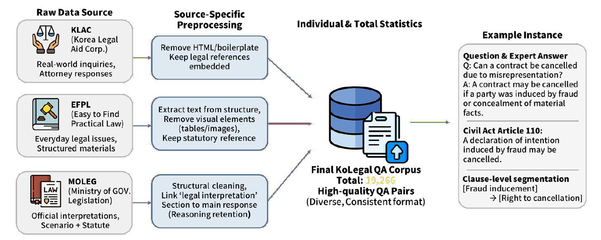

<div align="center">

# KoLegalQA

### A Korean Legal QA Dataset for Trustworthy and Explanation-Grounded Legal AI

**19,266 Legal QA Pairs · 3 Official Sources · 6 Evaluated Language Models**

[**Paper**](https://github.com/infonet-gist/infonet-ai-KoLegalQA) · [**Repository**](https://github.com/infonet-gist/infonet-ai-KoLegalQA) · [**Dataset Details**](#dataset) · [**Results**](#benchmark-results)

</div>

---

## Overview

**KoLegalQA** is a Korean legal question-answering dataset derived from **19,266 real-world consultation cases** published by government-operated legal information services in South Korea. The source responses were authored or verified by legal professionals. Beyond question–answer pairs, the dataset preserves **statutory references** and, where available, **clause-level explanations**, supporting research on statute-associated and explanation-oriented legal response generation.

This repository accompanies the paper **“KoLegalQA: A Korean Legal QA Dataset for Trustworthy and Explanation-Grounded Legal AI.”** The work evaluates six Korean-capable language models before and after supervised fine-tuning using automated and human assessment.

## Dataset Construction

<p align="center">
  
</p>
<p align="center"><em>Dataset construction pipeline and instance illustration (Figure 1 of the paper; cropped from the original figure).</em></p>

The three sources undergo source-specific cleaning while retaining legally meaningful content. For MOLEG, legal interpretation sections are additionally linked to their corresponding answers.

## Dataset

| Source | Description | QA pairs | Share |
|:--|:--|--:|--:|
| **KLAC** — Korea Legal Aid Corporation | Legal consultation questions and attorney responses | 9,618 | 49.9% |
| **EFPL** — Easy to Find Practical Law | Everyday legal guidance and structured Q&A | 2,156 | 11.2% |
| **MOLEG** — Ministry of Government Legislation | Official legal interpretations and statutory reasoning | 7,492 | 38.9% |
| **Total** | | **19,266** | **100%** |

### What does one instance represent?

A record centers on a **legal question** and a **professional answer**. Related statutory citations and clause-level explanatory information are preserved **when present**. Annotation density differs by source; **not every instance contains a statutory citation or a clause-level summary**.

The diagram above shows an illustrative example. It should not be interpreted as an exact serialization schema. For exact field names and storage format, consult the released data files and data-loading scripts.

### Source references

- [Korea Legal Aid Corporation (KLAC)](https://www.klac.or.kr/legalinfo/counsel.do)
- [Easy to Find Practical Law (EFPL)](https://easylaw.go.kr/CSP/OnhunqueansLstRetrieve.laf)
- [Ministry of Government Legislation (MOLEG)](https://www.moleg.go.kr/lawinfo/nwLwAnList.mo?mid=a10106020000)

## Benchmark Setup

| Component | Paper configuration |
|:--|:--|
| Task | Supervised Korean legal response generation |
| Models | Beomi, Bllossom, Gemma, Monarch, Princeton, Seokdong (7B–9B) |
| Training | 4-bit NF4 quantization + LoRA (rank 16, alpha 32, dropout 0.05) |
| Split | Random 80% train / 20% held-out, fixed seed |
| Model selection | Lowest evaluation loss on the held-out split |
| Generation | Greedy decoding, up to 512 new tokens |
| Automated evaluation | GPT-4o-based G-Eval, 1–5 scores |
| Human evaluation | 100 sampled held-out questions; 12 graduate-student evaluators; 3 ratings per question–model pair |

**Evaluation criteria:** conclusion correctness (CC), legal reasoning validity (LR), citation relevance (CR), and clarity and tone (CL). **Legal-score** is the mean of CC, LR, and CR; **Overall** is the mean of all four criteria.

> **Evaluation caveat:** The held-out portion was used both for checkpoint selection and final evaluation. It is therefore not a separately untouched test set. The human evaluation involved graduate-student raters, not a panel of licensed legal professionals.

## Benchmark Results

### G-Eval overall scores (1–5; higher is better)

| Model | Base | Fine-tuned | Change |
|:--|--:|--:|--:|
| Beomi | 2.41 | 2.98 | +0.57 |
| Bllossom | 1.75 | 2.59 | +0.84 |
| Gemma | **3.51** | 3.11 | −0.40 |
| Monarch | 2.59 | 2.88 | +0.29 |
| Princeton | 1.70 | 2.68 | +0.98 |
| Seokdong | 3.06 | **3.21** | +0.15 |

**Five of six models** improve in overall G-Eval score after fine-tuning; **Gemma declines**. Seokdong achieves the highest overall score among fine-tuned models (3.21), while Princeton shows the largest overall gain (+0.98). These are automated evaluator scores, **not independently verified legal accuracy rates**.

### Alignment with human ratings

On the human-rated subset, the Spearman correlation between automated and human overall scores is **ρ = 0.64**; the overall inter-rater agreement is **ICC(2,3) = 0.50**. The paper reports confidence intervals and per-criterion results in Table 2.

## Getting Started

Clone the repository:

```bash
git clone https://github.com/infonet-gist/infonet-ai-KoLegalQA.git
cd infonet-ai-KoLegalQA
```

**Repository-specific instructions:** The exact installation, preprocessing, training, and evaluation commands depend on the released code layout. They are intentionally not invented here. Before publishing, this section should link to the repository's actual environment file(s), entry-point script(s), configuration(s), and dataset-access instructions.

### Reproducing the paper

To reproduce the reported comparison, match the paper's train/evaluation split, preprocessing, model revisions, LoRA hyperparameters, decoding parameters, and four evaluation rubrics. See Sections 3–4 and the appendices of the accompanying paper for the documented protocol. Model access and any external evaluation API may require separate permissions or credentials.

## Intended Use and Limitations

KoLegalQA is intended for **research and evaluation of Korean legal language models**, not as a validated legal advisory service.

- Statutory annotations are not uniformly present across the three sources.
- Citation relevance was rated, but the experiment did not independently verify every cited law against a live legal database.
- The evaluation uses an LLM judge and non-expert human assessors rather than case-by-case legal-professional adjudication.
- Consultation records and applicable law may become outdated; users should verify current statutes and consult qualified professionals for real legal decisions.

## Data Availability and Licensing

Publicly accessible government pages do **not** necessarily permit unrestricted redistribution of their content. Dataset release terms, source attribution, code license, and the availability of individual raw/processed files must be checked against the repository and source-specific terms before public distribution.

## Citation

If you use KoLegalQA, please cite the accompanying paper. Replace the entry below with the official proceedings citation/DOI once available:

```bibtex
@misc{lee2026kolegalqa,
  title  = {KoLegalQA: A Korean Legal QA Dataset for Trustworthy and Explanation-Grounded Legal AI},
  author = {Lee, Yongtae and Lee, Surin and Kim, Sumin and Rahman, S M Wahidur and Lee, Heung-No},
  year   = {2026},
  note   = {Manuscript; see the repository for the latest publication details},
  url    = {https://github.com/infonet-gist/infonet-ai-KoLegalQA}
}
```

---

<div align="center">

**KoLegalQA · Gwangju Institute of Science and Technology (GIST)**

</div>
